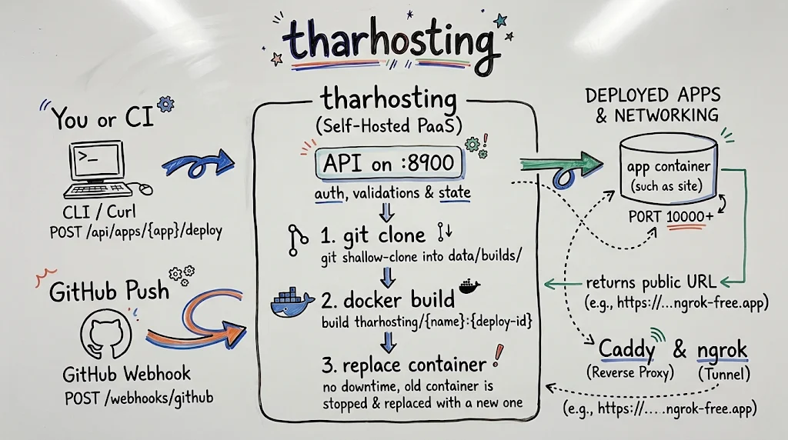

# tharhosting

[](https://github.com/tharcissentirandekura/tharhosting/actions/workflows/actions.yml)


A lightweight, self-hosted PaaS (Platform-as-a-Service) written in Rust. Register a git repository that has a `Dockerfile` at its root; **tharhosting** will shallow-clone it, build the Docker image, replace the existing container without downtime, and serve it on its own host port. Connect GitHub webhooks to automate redeployment on every push.

---
View tasks you can contribute to.
https://github.com/users/tharcissentirandekura/projects/11/views/3

> [!NOTE]
While this is going to be a fully functional lightweight platform, I am focused more on the backend components which I think is the core parts of this service. So, if you love frontend and want to contribute that part, please do so. For now, I haven't added guides and information regarding what I will be using to build the frontend component of this service but I am leaning toward React with typescript since I have experience building products and tools in this framework. But, I also have strong interest for Rust language given its use and speed in low level or critical applications. Of course, this project won't need to use Rust for frontend and may be backend too but I have been using Rust in my classes and this project serves as a great place to play around those tools and get comfortable. why not! YOU SHOULD DO.

## Architecture Flow

For my design doc and design system, I have the high-level system design of the tharhosting pipeline, capturing how deploy commands trigger secure builds and expose them publicly. There should be more but I hope this gives you an idea of how the platform operates or at least is going to. So, if you are interested in this project, feel free to let me know and we can even chat about it. I LOVE TALKING ABOUT MY PROJECT (but only if you are interested)

<p align="center">
  
</p>

---

## To get started, here is a guide of the system

You need **Rust**, **git**, and a **running Docker daemon** on your host.

```bash
THARHOSTING_TOKEN=change-me cargo run --release
```

All application state is kept locally in a `data/` directory at the root of the project (`data/db.json`, `data/builds/`, `data/logs/`). This directory is git-ignored and self-contained. 
> [!TIP]
> You can generate a token of random bytes in hexadecimal using `openssl rand -hex 32` and use that as the token env variable value.

### Environment Configuration

Customize your instance by setting the following environment variables:

| Variable | Default | Meaning |
|---|---|---|
| `THARHOSTING_HOST` | `127.0.0.1` | The network interface the API binds to |
| `THARHOSTING_PORT` | `8900` | The port the API listens on |
| `THARHOSTING_DATA` | `data` | Directory where database, build directories, and logs are stored |
| `THARHOSTING_TOKEN` | *unset* | If set, all `/api/*` requests require `Authorization: Bearer <token>` |
| `THARHOSTING_WEBHOOK_SECRET` | *unset* | If set, incoming GitHub webhooks must be cryptographically signed with it |
| `THARHOSTING_APP_PORT_START` | `10000` | The first port given to host-bound user containers |
| `THARHOSTING_APP_BIND` | `0.0.0.0` | The host interface where app container ports are published |
| `THARHOSTING_PUBLIC_HOST` | `localhost` | The hostname used when generating public app URLs |
| `THARHOSTING_DOCKER` | `docker` | Path to the Docker CLI binary |
| `THARHOSTING_GIT` | `git` | Path to the Git binary |

---

## The App Contract

To run your app on tharhosting, your repository must fulfill this simple contract:

1. **Dockerfile**: Include a `Dockerfile` at your repo's root. To use an alternative path (e.g., `docker/Dockerfile.prod`), set the `dockerfile` field in your app config.
2. **Dynamic Port Binding**: Ensure your application listens on the `$PORT` environment variable (the internal container port defaults to `8080` unless specified otherwise in `container_port`).

---

## API Documentation

Apps can be managed and deployed via the HTTP API using either their user-defined `name` or UUID `id`. 
*If a `THARHOSTING_TOKEN` is configured, be sure to pass `-H "Authorization: Bearer $TOKEN"` with your `/api` calls.*

### 1. Discovery & Diagnostics
```bash
# Check API health (No auth required)
curl localhost:8900/api/health                     # Returns {"ok":true} (also matches / and /health)

# List all available routes (Authentication required)
curl localhost:8900/api
```

### 2. Application Life Cycle
```bash
# Create and deploy a new app
curl -X POST localhost:8900/api/apps \
  -H 'Content-Type: application/json' \
  -d '{
    "name": "site",
    "repo_url": "[https://github.com/you/site.git](https://github.com/you/site.git)",
    "branch": "main",
    "dockerfile": "Dockerfile",
    "container_port": 8080,
    "env": {"GREETING": "hi"},
    "deploy": true
  }'

# View all apps
curl localhost:8900/api/apps

# Get specific app details (includes state and endpoint)
curl localhost:8900/api/apps/site

# Edit an app's config (changes apply on next deploy)
curl -X PATCH localhost:8900/api/apps/site \
  -H 'Content-Type: application/json' \
  -d '{"branch":"prod"}'

# Force a manual redeploy (409 Conflict if a deploy is already running)
curl -X POST localhost:8900/api/apps/site/deploy

# Stop/Start
curl -X POST localhost:8900/api/apps/site/stop
curl -X POST localhost:8900/api/apps/site/start

# Destroy (completely removes container, build directory, image, & logs)
curl -X DELETE localhost:8900/api/apps/site
```

### 3. Deployments & Live Logs
```bash
# Get deployment history (newest first)
curl localhost:8900/api/apps/site/deployments

# View deployment info by ID
curl localhost:8900/api/deployments/<id>

# Fetch / tail build and run logs (returns plain text)
curl localhost:8900/api/deployments/<id>/logs
```

> **Log Streaming Tip**: The logs endpoint responds with `X-Log-Offset` (use this in `?offset=N` to tail new output) and `X-Deploy-Done: true|false` to easily poll progress until the build is complete.

---

## Behind the Scenes: Deploy Behavior

When a deployment is triggered (either manually or via webhook):
1. **Isolated Build**: The git repository is shallow-cloned into `data/builds/<app-id>`.
2. **Docker Compilation**: It triggers `docker build -t tharhosting/<name>:<deploy-id>`.
3. **No-Downtime Swap**: Only if compilation succeeds is the existing `th-<name>` container stopped and immediately replaced.
   * `Restart Policy`: All app containers run with `--restart unless-stopped`.
   * `Graceful Failover`: If cloning or building fails, **the previous container remains running and unaffected.** Any crash/reboot during deployment registers the run as Failed on startup.

### GitHub Webhook Integration

Expose your server endpoint `http(s)://<your-host>/webhooks/github` and point your GitHub Repository Webhook here. 
- **Content Type**: `application/json`
- **Security**: Must match your local `THARHOSTING_WEBHOOK_SECRET` key if one is defined.

On push event, every registered app matching both the incoming repo (all standard SSH/HTTPS formats supported) and active target branch triggers a parallel, hands-free redeployment.

---

More features to come! Feel free to raise issues or pull requests. I am using this to learn different topics, so it is open to everyone to try.
