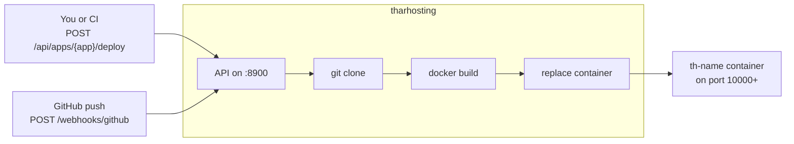

# tharhosting

[](https://github.com/tharcissentirandekura/tharhosting/actions/workflows/actions.yml)


A small self-hosted PaaS written in Rust. Register a git repo that has a
`Dockerfile` at its root; tharhosting clones it, runs `docker build`, and
starts the container on its own host port. Pushes to GitHub can redeploy it
automatically.




## Run it

You need Rust, git, and a running Docker daemon.

```bash
THARHOSTING_TOKEN=change-me cargo run --release
```

Everything it writes goes in `data/` next to where you start it, i.e. the
project folder (`data/db.json`, `data/builds/`, `data/logs/`). It is git-ignored.

### Configuration

| Variable | Default | Meaning |
|---|---|---|
| `THARHOSTING_HOST` | `127.0.0.1` | Address the API binds to |
| `THARHOSTING_PORT` | `8900` | API port |
| `THARHOSTING_DATA` | `data` (relative to the working directory) | Data directory |
| `THARHOSTING_TOKEN` | unset | If set, `/api/*` requires `Authorization: Bearer <token>` |
| `THARHOSTING_WEBHOOK_SECRET` | unset | If set, GitHub webhooks must be signed with it |
| `THARHOSTING_APP_PORT_START` | `10000` | First host port given to apps |
| `THARHOSTING_APP_BIND` | `0.0.0.0` | Interface app ports are published on |
| `THARHOSTING_PUBLIC_HOST` | `localhost` | Hostname used in app URLs |
| `THARHOSTING_DOCKER` / `THARHOSTING_GIT` | `docker` / `git` | Binaries to call |

## Your app's contract

- A Dockerfile in the repo. By default `Dockerfile` at the root; set
  `dockerfile` (e.g. `docker/Dockerfile.prod`) to use another path.
- Listen on `$PORT` (set to `container_port`, default `8080`).

## API

Apps can be addressed by name or id. With a token set, add
`-H "Authorization: Bearer $TOKEN"` to every `/api` call.

```bash
# Discover the API and check health
curl localhost:8900/api                            # list of all routes (needs the token)
curl localhost:8900/api/health                     # {"ok":true}, no token (also / and /health)

# Create and deploy
curl -XPOST localhost:8900/api/apps -H 'content-type: application/json' -d '{
  "name": "site",
  "repo_url": "https://github.com/you/site.git",
  "branch": "main",
  "dockerfile": "Dockerfile",
  "container_port": 8080,
  "env": {"GREETING": "hi"},
  "deploy": true
}'

curl localhost:8900/api/apps                       # list
curl localhost:8900/api/apps/site                  # details + live container state + url
curl -XPATCH localhost:8900/api/apps/site -d '{"branch":"prod"}' -H 'content-type: application/json'
curl -XPOST localhost:8900/api/apps/site/deploy    # redeploy (409 if one is running)
curl -XPOST localhost:8900/api/apps/site/stop
curl -XPOST localhost:8900/api/apps/site/start
curl -XDELETE localhost:8900/api/apps/site         # removes container, images, logs

curl localhost:8900/api/apps/site/deployments      # newest first
curl localhost:8900/api/deployments/<id>
curl localhost:8900/api/deployments/<id>/logs      # text; ?offset=N to tail
```

The logs endpoint returns `x-log-offset` (pass it back as `?offset=`) and
`x-deploy-done: true|false` so a client can poll until the build finishes.

PATCH changes (branch, dockerfile, env, port, repo) take effect on the next deploy.

### Deploy behaviour

1. Shallow-clone the branch into `builds/<app-id>`.
2. `docker build -t tharhosting/<name>:<deploy-id>`.
3. Only if the build succeeds: replace container `th-<name>` (`--restart unless-stopped`).

If the clone or build fails, the version already running stays up. If the
server restarts mid-deploy, that deploy is marked failed on startup.

### GitHub webhook

Point a repo webhook at `http(s)://<host>/webhooks/github`, content type
`application/json`, with the same secret as `THARHOSTING_WEBHOOK_SECRET`.
A push redeploys every app whose `repo_url` (https, ssh, and `.git` forms all
match) and `branch` match the push.


More to come.
